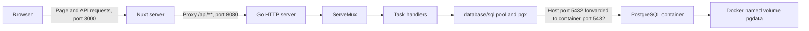
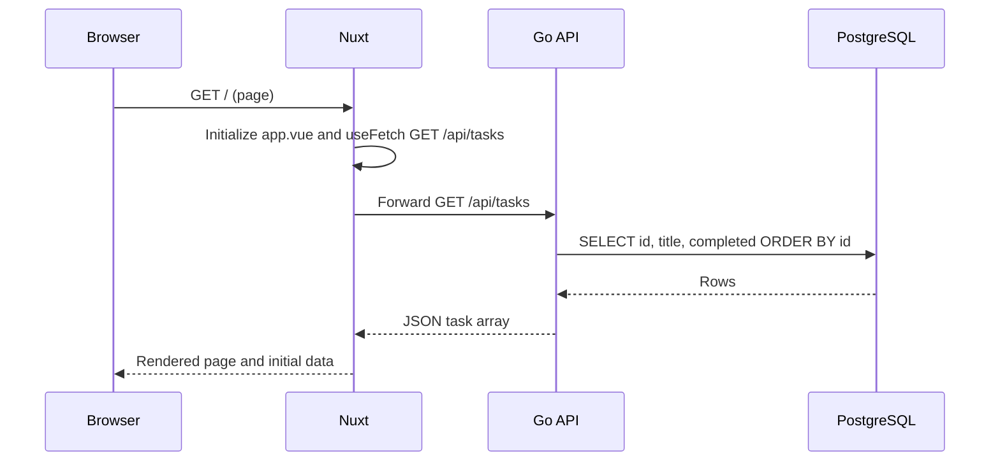

# Architecture and Request Workflow

## System boundary

This is one local full-stack application, not a microservice platform. Nuxt provides the web interface and a same-origin API proxy. Go owns input validation and SQL operations. PostgreSQL persists records. Only PostgreSQL is containerized in the current setup; Nuxt and Go run on the host.

## Technology choices and responsibilities

| Technology | Responsibility | Boundary |
| --- | --- | --- |
| Nuxt 4 / Vue 3 | Root component, reactive state, form and checkbox/button events, page rendering | Does not connect directly to PostgreSQL. |
| TypeScript | Task shape and function signatures during development | Interfaces do not validate received JSON at runtime. |
| Nuxt routeRules | Forward `/api/**` to the local Go server | Homepage `/` is not a task API request. |
| Go net/http | Listener, method/path matching, request/response handling | Does not serve the Nuxt UI. |
| database/sql + pgx | Shared pool and PostgreSQL communication | The pool is a Go object, not the database server. |
| PostgreSQL 17 | Identity IDs, stored task records, constraints | Actual files persist in Docker storage. |
| Docker Compose | Start the database and attach a volume/port mapping | Does not currently start Go or Nuxt. |

## Code map

| File | Responsibility |
| --- | --- |
| `backend/cmd/api/main.go` | Task/application types, environment lookup, routes, server, CRUD handlers. |
| `backend/cmd/api/database.go` | Pool setup and five-second startup connectivity check. |
| `backend/schema.sql` | Initial tasks table; applied once, not a migration framework. |
| `frontend/app/app.vue` | List state, creation, completion, edit draft/save/cancel, deletion and messages. |
| `frontend/nuxt.config.ts` | Nuxt settings and API forwarding target. |
| `compose.yaml` | PostgreSQL image, initial credentials, published port and persistent volume. |
| `.env.example` | Safe configuration template. Real `.env` is ignored. |

## Data model

| Field | PostgreSQL | Go | Frontend |
| --- | --- | --- | --- |
| id | bigint generated identity, primary key | int64, JSON key id | number |
| title | varchar(200), required, nonblank check | string | string |
| completed | boolean, required, default false | bool | boolean |

The API trims title whitespace and counts Unicode code points. The database independently enforces title length and its nonblank constraint. Generated IDs need not be contiguous.

The frontend uses JavaScript numbers. PostgreSQL bigint supports IDs beyond JavaScript's exact integer range; such enormous IDs are outside this exercise's practical dataset. A production API with that range would need an explicit string-ID contract.

## Startup sequence

1. Docker starts the PostgreSQL container and mounts pgdata at `/var/lib/postgresql/data`.
2. On an empty volume, PostgreSQL initializes the configured user/database. The developer applies schema.sql once.
3. The shell exports DATABASE_URL; Go reads it. `sql.Open` prepares a shared pool; `PingContext` verifies connectivity.
4. Go places the pool in application and registers method/path handlers in ServeMux, then listens on port 8080.
5. Nuxt starts separately, normally on port 3000, and applies its forwarding rules.

## First page load

Nuxt can fetch during server rendering and transfer the resulting state to the browser. It is not always a separate browser request after the page is visible. On the client, refresh() can reexecute the same list request. The important separation is page retrieval versus task-data retrieval, not an assumption that both must originate from the browser.

## User operations

| UI action | Event / function | API | After success |
| --- | --- | --- | --- |
| Submit new title | form submit → addTask | POST /api/tasks | Clear reusable input; refresh list. |
| Check/uncheck | checkbox change → toggleTask | PATCH /api/tasks/{id}, completed body | Refresh list. |
| Open editor | click → startEditingTask | No request | Copy selected ID/title into frontend draft state. |
| Cancel edit | click → cancelEditingTask | No request | Discard draft and close editor. |
| Submit edited title | form submit → editTaskTitle | PATCH /api/tasks/{id}, title body | Close editor; refresh list. |
| Delete | click → deleteTask | DELETE /api/tasks/{id} | Refresh list so the deleted item disappears. |

PATCH accepts optional title and completed, or both. Nil fields are omitted; at least one non-nil field is required. COALESCE preserves the existing value for an omitted field. The SQL statement uses positional parameters rather than interpolating input into SQL.

## State, concurrency and errors

- Vue refs hold reactive state. The script writes `.value`; templates unwrap it. Updating list data makes the template rerender.
- Busy flags prevent repeated same-operation submissions. Editing saves, completion updates and deletion guard against overlapping with each other; creation has its own flag. This is local UI protection, not a global transaction scheduler or duplicate-request guarantee.
- Await waits for the current request before the function refreshes the list. It does not freeze the entire browser or automatically serialize every request.
- Creation, completion, editing and deletion have separate error messages. List data/error come from useFetch. Template conditions control what is displayed, not when handlers execute.
- Input or request errors return 400; missing rows return 404; database failures return 500; successful deletion returns 204 without a body.
- Detailed database errors are logged by Go; UI messages are intentionally simple. A list refresh failure is distinct from a successful mutation and must not be assumed to undo the database write.
- Startup PingContext and each database operation use five-second contexts. The per-operation deadline is not an entire HTTP request timeout; JSON decoding and response writing are outside that database deadline.
- Result sets close after reads, and context cancellation releases associated resources. The current `log.Fatal(ListenAndServe())` startup pattern exits without running deferred cleanup on fatal exit; graceful shutdown is not implemented.

## Storage, local networking and limitations

`5432:5432` maps a host port to the database container port. A Go process on the host connects to localhost:5432. If Go later moves into a separate container on the same Compose network, it would connect to db:5432 instead. The current hardcoded Nuxt proxy assumes Go is reachable on the same host as the Nuxt server.

pgdata is a named storage volume; the container data directory is its mount point. Normal container stop/recreation preserves the volume. Explicit volume deletion destroys the database files.

This exercise currently has no authentication, authorization, pagination, automated test suite, migration runner or production deployment configuration. It is a local demonstration. A public deployment needs a deliberate environment/proxy/credential configuration and an exposure decision, rather than sharing a localhost URL.

## Public demonstration

The public browser loads Nuxt from Vercel Hobby. Its `/api/**` route proxies to the Go API on Render Free; Go connects to PostgreSQL 17 on Neon Free using SSL. The API and database are in Frankfurt. The frontend reads `API_PROXY_TARGET` during its build; the Go process reads `DATABASE_URL` and `PORT` at runtime. No database credentials are sent to the browser.

Production URLs and the acceptance record are in `free-deployment.md`. Automatic Git deployments update application code, not the database schema. The demo has no authentication and is intended only for disposable shared data.
